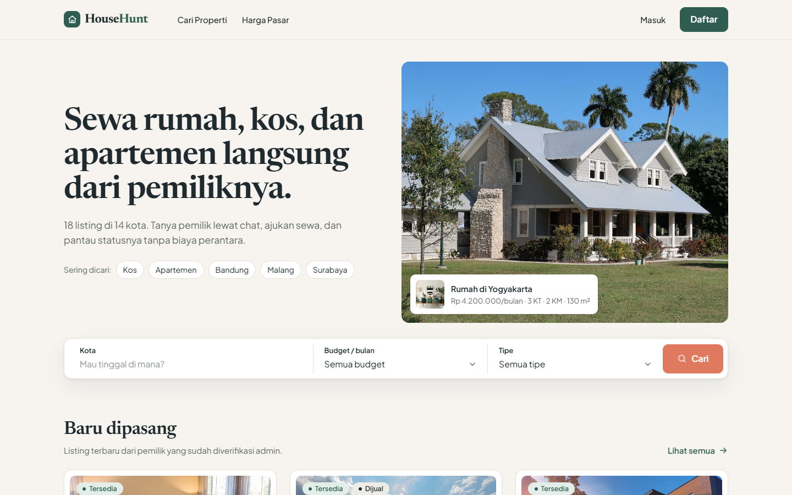
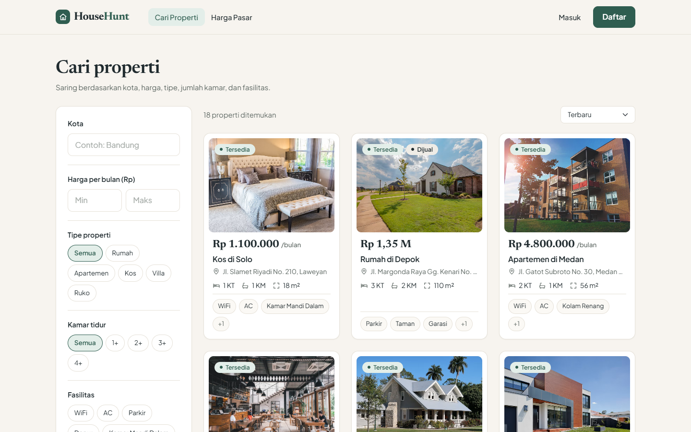
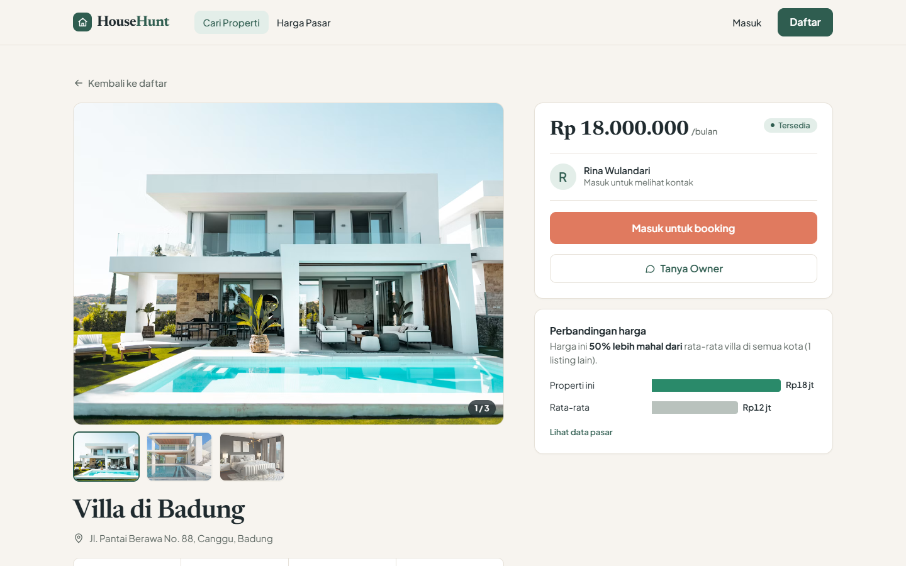
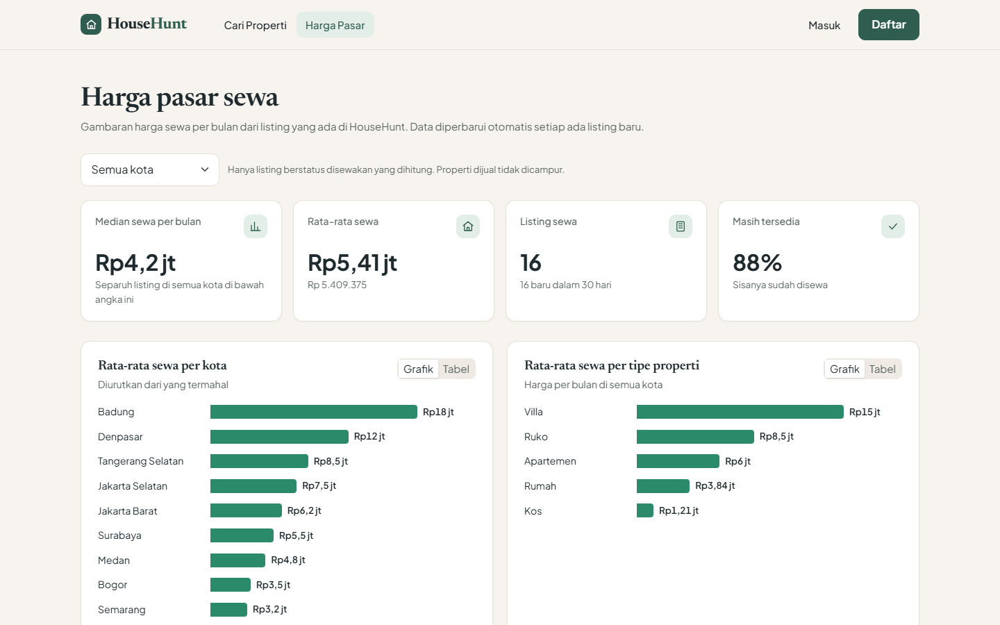
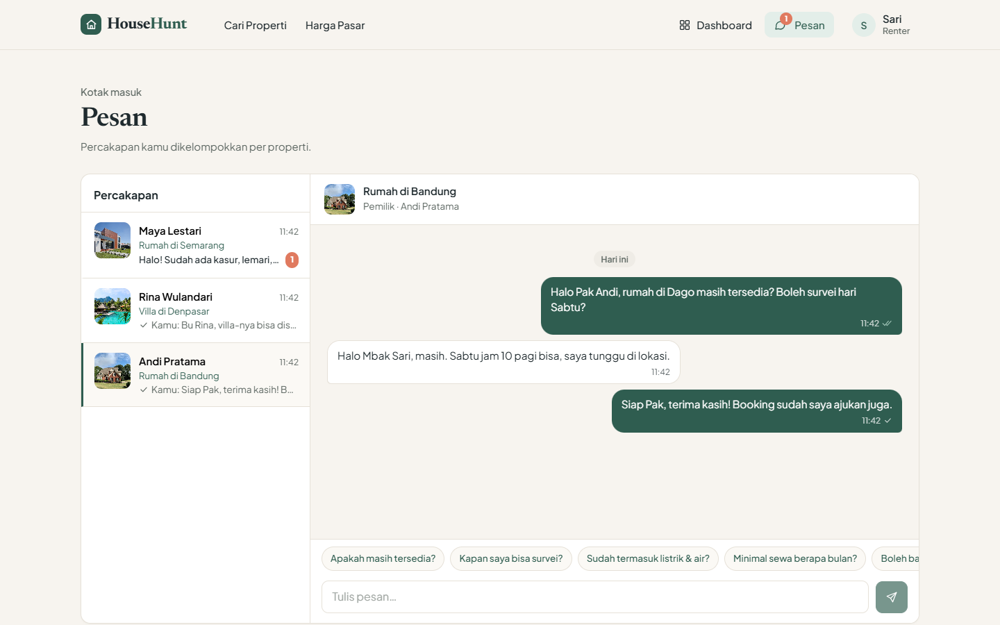
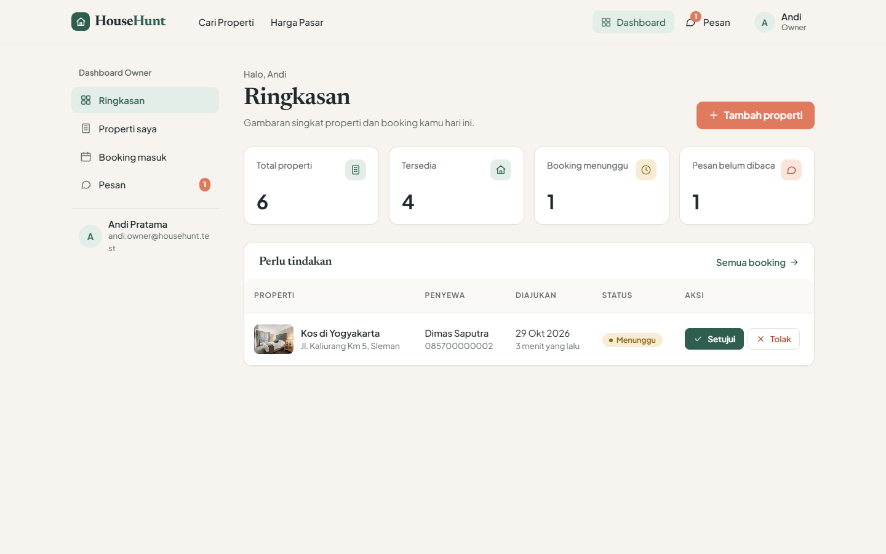
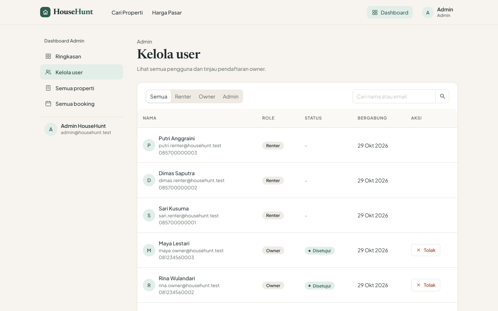
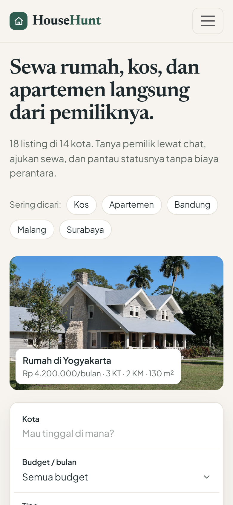
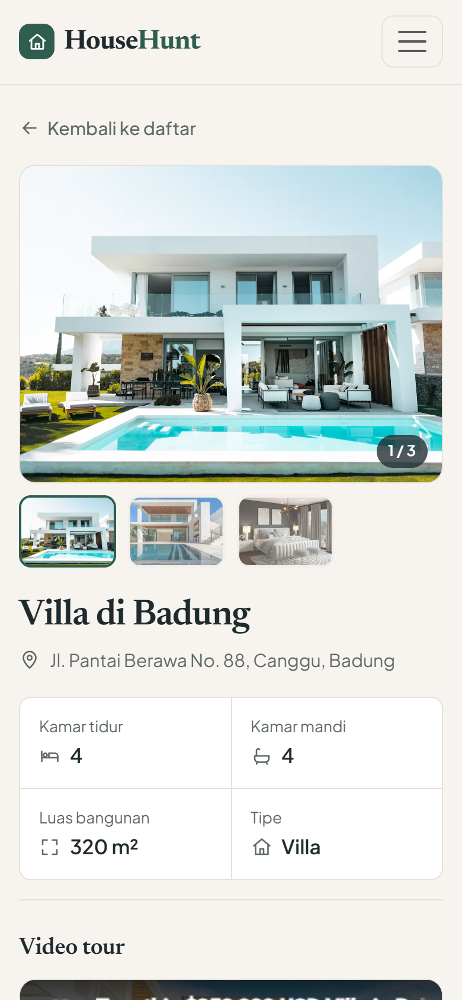

# HouseHunt

Aplikasi web sewa properti yang menghubungkan pemilik dan penyewa secara langsung, tanpa perantara. Dibangun dengan MERN stack (MongoDB, Express, React, Node.js).

Penyewa bisa mencari dan memfilter properti, melihat video tour, membandingkan harga dengan data pasar, bertanya ke pemilik lewat chat, lalu mengajukan booking. Pemilik mengelola listing dan booking dari dashboard. Admin memverifikasi akun pemilik sebelum mereka bisa memasang listing.



## Fitur

**Penyewa (renter)**
- Cari properti dengan filter kota, rentang harga, tipe, jumlah kamar tidur, fasilitas, dan ketersediaan. Filter tersimpan di URL sehingga hasil pencarian bisa dibagikan.
- Halaman detail berisi galeri foto, spesifikasi (kamar tidur, kamar mandi, luas), video tour YouTube, dan perbandingan harga dengan rata-rata properti sejenis.
- Ajukan booking dan pantau statusnya (menunggu, disetujui, ditolak).
- Chat dengan pemilik per properti, lengkap dengan tanda terkirim/dibaca dan pertanyaan cepat.

**Pemilik (owner)**
- Mendaftar, lalu menunggu verifikasi admin. Dashboard terbuka otomatis setelah disetujui.
- Tambah, ubah, dan hapus listing dengan upload hingga 6 foto (JPG/PNG/WEBP, maksimal 2 MB per foto).
- Setujui atau tolak booking. Saat satu booking disetujui, properti otomatis berstatus disewa dan booking lain yang masih menunggu ditolak.
- Balas pertanyaan calon penyewa.

**Admin**
- Ringkasan statistik platform.
- Kelola user: cari, filter per role, serta setujui atau tolak akun pemilik.
- Lihat semua properti dan booking.

**Harga pasar (market insights)**
- Median dan rata-rata harga sewa, tingkat ketersediaan, dan listing baru dalam 30 hari.
- Rata-rata sewa per kota dan per tipe properti (termasuk harga per m²), sebaran harga, dan fasilitas yang paling umum.
- Bisa difilter per kota. Setiap grafik punya tampilan tabel.
- Semua angka dihitung langsung di MongoDB dengan aggregation pipeline (`$facet`, `$median`, `$bucket`).

| | |
|---|---|
|  |  |
|  |  |
|  |  |

<p>
  
  
</p>

## Tech stack

| Bagian | Teknologi |
|---|---|
| Frontend | React 19 (Vite), React Router 7, React Bootstrap, Material UI, Ant Design, MDB React UI Kit, Axios, Moment |
| Backend | Node.js, Express 5, Mongoose 9, JSON Web Token, bcryptjs, Multer, CORS, dotenv |
| Database | MongoDB Atlas |

Tema ketiga library UI (Bootstrap, MUI, Antd) diseragamkan dari satu sumber token di `frontend/src/theme/`, sehingga warna, font, dan radius konsisten di seluruh aplikasi.

## Struktur folder

```
houserent/
├── backend/
│   ├── config/config.js         koneksi MongoDB Atlas
│   ├── controllers/             logika tiap fitur (auth, property, booking, owner, admin, message, insights)
│   ├── middleware/              verifikasi JWT + cek role, upload gambar (multer)
│   ├── models/                  skema User, Property, Booking, Message
│   ├── routes/                  userRoutes, ownerRoutes, adminRoutes, messageRoutes
│   ├── scripts/createAdmin.js   membuat akun admin
│   ├── seed.js                  data contoh
│   └── index.js
├── frontend/
│   └── src/
│       ├── api/                 instance axios + interceptor token
│       ├── components/          komponen reusable (kartu properti, chat, grafik, layout)
│       ├── context/             AuthContext, UnreadContext
│       ├── pages/               halaman publik + dashboard per role
│       └── theme/               token desain + tema MUI, Antd, override Bootstrap
└── docs/screenshots/
```

## Menjalankan di komputer sendiri

Prasyarat: Node.js 18 atau lebih baru, dan cluster MongoDB Atlas (versi 7 ke atas, karena halaman insights memakai `$median`).

**1. Backend**
```bash
cd backend
npm install
cp .env.example .env        # lalu isi MONGO_URI dan JWT_KEY
npm run seed                # opsional: isi data contoh
npm run dev                 # http://localhost:8000
```

**2. Frontend** (di terminal lain)
```bash
cd frontend
npm install
cp .env.example .env        # VITE_API_URL=http://localhost:8000
npm run dev                 # http://localhost:5173
```

Pastikan IP kamu sudah diizinkan di **Network Access** pada MongoDB Atlas.

**Akun demo** (setelah `npm run seed`, password semua akun: `password123`)

| Role | Email |
|---|---|
| Renter | sari.renter@househunt.test |
| Owner | andi.owner@househunt.test |
| Admin | admin@househunt.test |

Akun admin sendiri bisa dibuat dengan `npm run create-admin -- "Nama" email@domain.com password`.

## API

Semua respons memakai format `{ success, message, data }`. Route yang butuh login memakai header `Authorization: Bearer <token>`.

| Method | Endpoint | Akses | Fungsi |
|---|---|---|---|
| POST | `/api/users/register` | Publik | Daftar sebagai renter atau owner |
| POST | `/api/users/login` | Publik | Login, mendapat token JWT |
| GET | `/api/users/me` | Login | Data user yang sedang login |
| GET | `/api/users/properties` | Publik | Daftar properti + filter + pagination |
| GET | `/api/users/properties/:id` | Publik | Detail properti + perbandingan harga pasar |
| GET | `/api/users/cities` | Publik | Jumlah properti per kota |
| GET | `/api/users/insights` | Publik | Statistik harga pasar (`?city=`) |
| POST, GET | `/api/users/bookings` | Renter | Ajukan booking, lihat booking sendiri |
| GET, POST | `/api/owner/properties` | Owner | Daftar dan tambah properti (multipart) |
| GET, PUT, DELETE | `/api/owner/properties/:id` | Owner | Detail, ubah, hapus properti |
| GET | `/api/owner/bookings` | Owner | Booking untuk properti milik sendiri |
| PATCH | `/api/owner/bookings/:id/status` | Owner | Setujui atau tolak booking |
| GET | `/api/admin/stats` | Admin | Ringkasan statistik |
| GET | `/api/admin/users` | Admin | Daftar user + filter + pencarian |
| PATCH | `/api/admin/owners/:id/approve` · `/reject` | Admin | Verifikasi akun owner |
| GET | `/api/admin/properties` · `/bookings` | Admin | Semua properti dan booking |
| POST | `/api/messages` | Renter, Owner | Kirim pesan terkait properti |
| GET | `/api/messages/conversations` | Renter, Owner | Daftar percakapan + jumlah belum dibaca |
| GET | `/api/messages/property/:id` | Renter, Owner | Isi satu percakapan |
| PATCH | `/api/messages/property/:id/read` | Renter, Owner | Tandai pesan sudah dibaca |
| GET | `/api/messages/unread-count` | Renter, Owner | Total pesan belum dibaca |

## Catatan teknis

- **Keamanan.** Password di-hash dengan bcrypt dan tidak pernah dikirim ke client (`select: false` + transform `toJSON`). Setiap request terproteksi mengambil ulang data user dari database, sehingga perubahan status (misalnya owner disetujui atau ditolak) langsung berlaku tanpa login ulang.
- **Performa.** Index pada `city`, `rentAmount`, `propertyType`, `bedrooms`, dan `amenities` (multikey), ditambah compound index untuk kombinasi filter yang paling umum. Daftar properti memakai pagination, dan halaman dashboard di-*lazy load*.
- **Chat.** Pesan baru diambil dengan polling (2,5 detik saat chat terbuka) dan dikirim secara *optimistic*. WebSocket tidak dipakai supaya stack tetap sesuai ketentuan proyek.
- **Upload.** Multer membatasi tipe (JPG/PNG/WEBP), ukuran (2 MB), dan jumlah file (6). Nama file dibuat acak, dan file yang tidak lagi dipakai dihapus dari disk.

## Rencana pengembangan

- Deploy (backend dan frontend) beserta konfigurasi environment produksi.
- Perjanjian sewa digital dan pencatatan pembayaran.
- Chat real-time dengan WebSocket.

## Kredit

Foto properti contoh dari [Unsplash](https://unsplash.com) ([Unsplash License](https://unsplash.com/license)). Video tour contoh adalah video publik di YouTube milik pembuatnya masing-masing.
